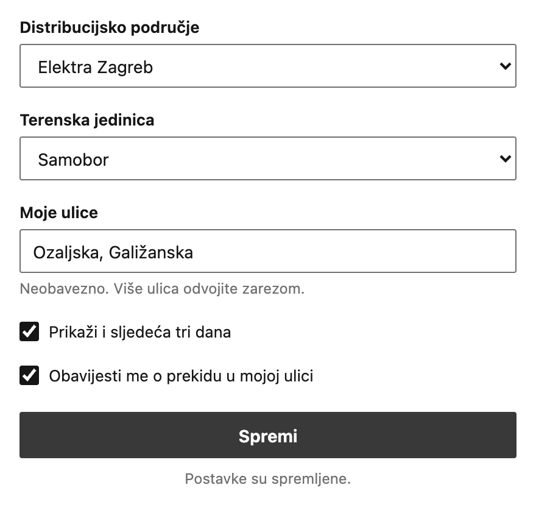
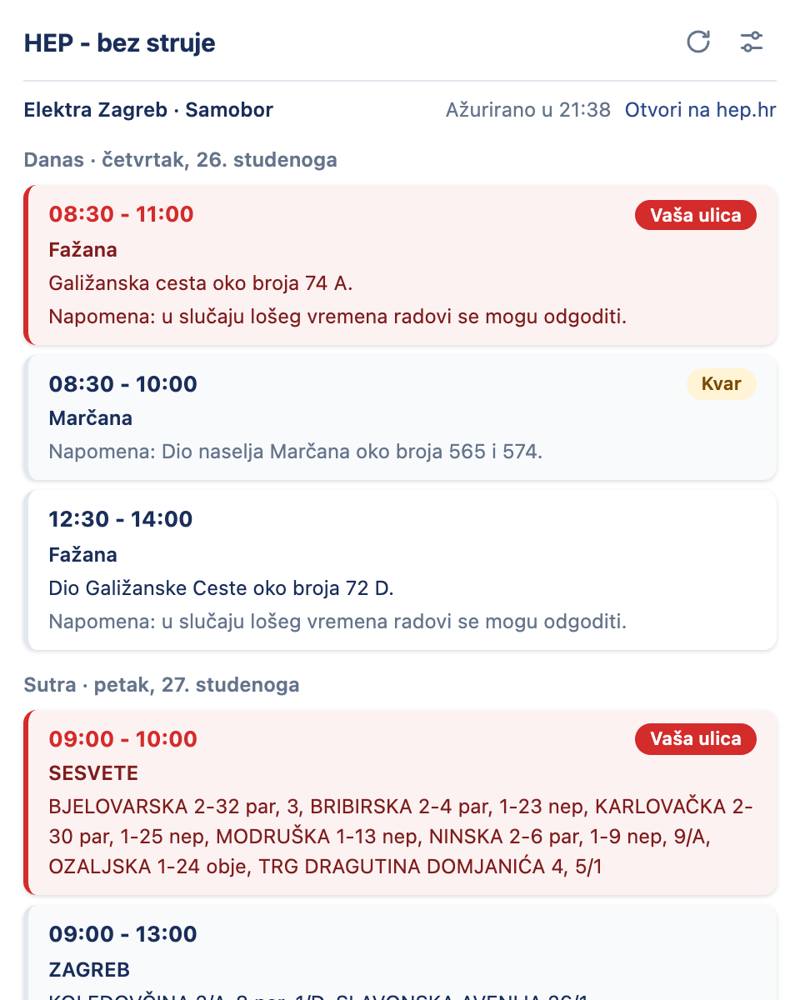
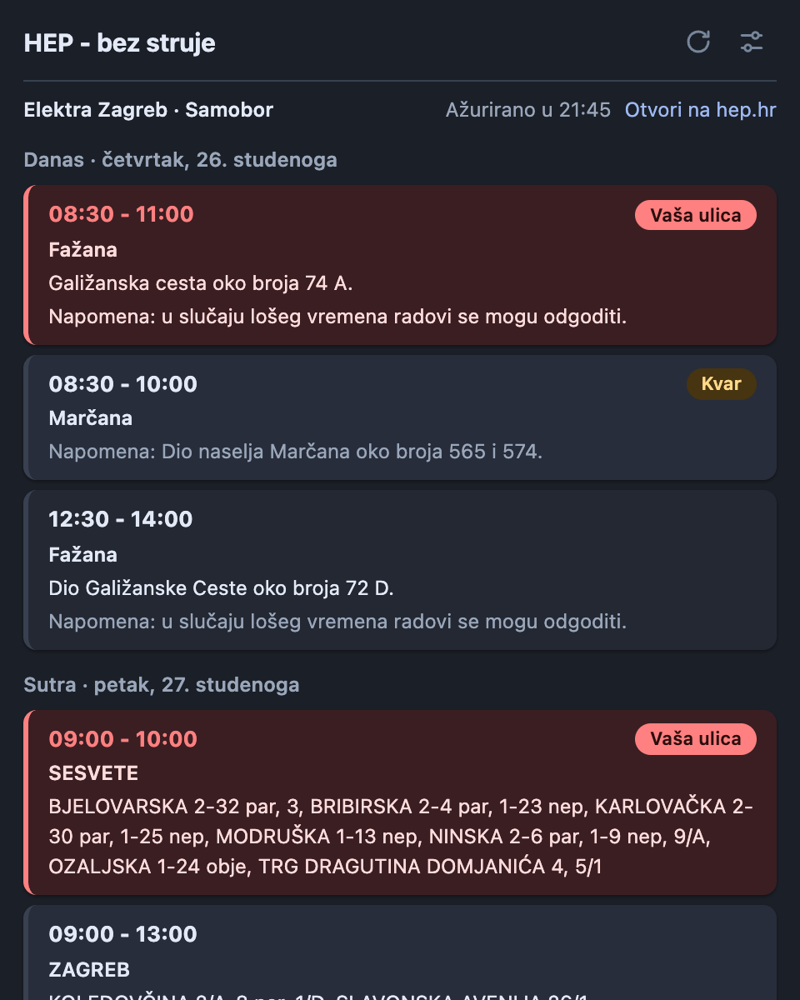
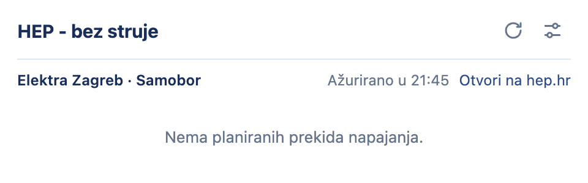

# Hep - bez struje


[](https://github.com/dineeek/hep-bez-struje/actions/workflows/lint-test-build.yml)
[](https://github.com/prettier/prettier)


Unofficial HEP Chrome extension for checking areas without electric power. Based
on HEP web page data scraping, TypeScript & React.

## Download

Available at
[**Chrome Web Store**](https://chrome.google.com/webstore/detail/hep-bez-struje/hahhmkkofmofnadefiadmpmcencoaljf).


## Screenshots

| Settings | Outage list | Dark theme | No outages |
|-|-|-|-|
|  |  |  |  |

## Features

- Planned and unplanned outages for the selected distribution area and station,
  grouped by day
- Today only, or today and the next three days
- Highlight and toolbar badge for outages on your streets. You can save several
  streets, and they match without diacritics or capitals.
- Background check every three hours, with an optional desktop notification
- The last result is kept locally, so the popup opens without waiting for HEP
- Light and dark theme
- Available localization:
  - German
  - English
  - Croatian
  - Hungarian
  - Slovenian

## Tech stack

- React 19 with TypeScript 6
- Vite 8 with @crxjs/vite-plugin
- Vitest for unit tests, Playwright for tests of the built extension
- ESLint + Prettier for code quality
- Chrome Extension Manifest V3

## Development

```bash
npm install            # install dependencies
npm run dev            # start dev server
npm run build          # production build to dist/
npm run check          # lint, typecheck, unit tests and build
npm run test:e2e       # run the built extension in Chromium against a local HEP stand-in
npm run sync:stations  # refresh the area and station list from hep.hr
npm run screenshots    # regenerate the screenshots above
```

Node comes from `.nvmrc`. Run `npx playwright install chromium` once before
`npm run test:e2e`.

## Permissions

- `storage` saves your settings and the last fetched outage list.
- `alarms` runs the background check every three hours.
- Access to `https://www.hep.hr/*` reads the outage pages. The extension asks
  for no other site.
- `notifications` is optional. Chrome asks for it only when you switch on outage
  notifications in the settings.

## Contributing

Contributions and upgrade ideas are welcome!

## License

MIT License

Copyright (c) 2026 Dino Klicek
